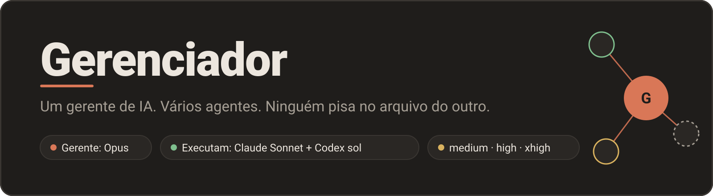
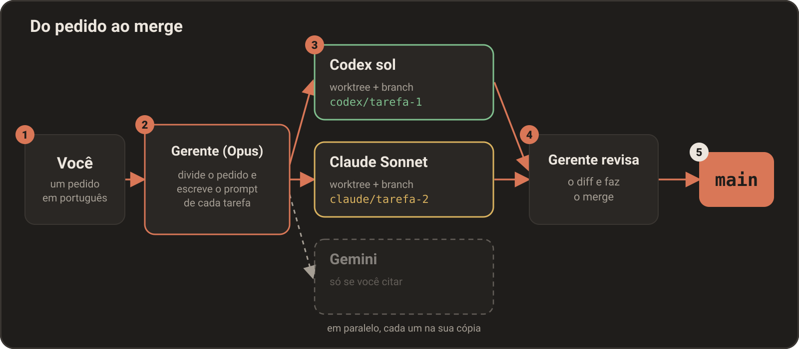
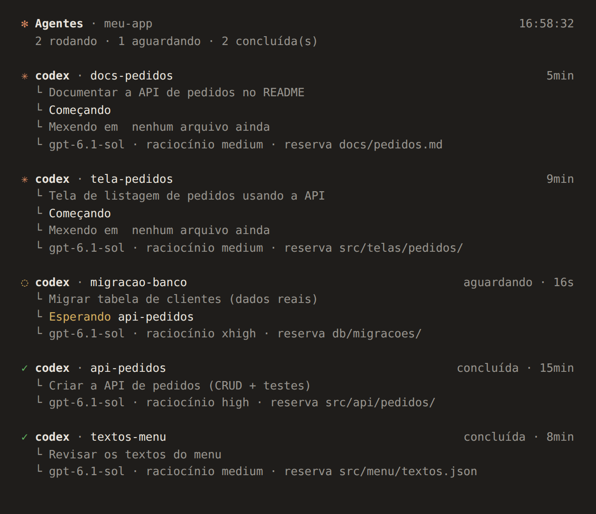
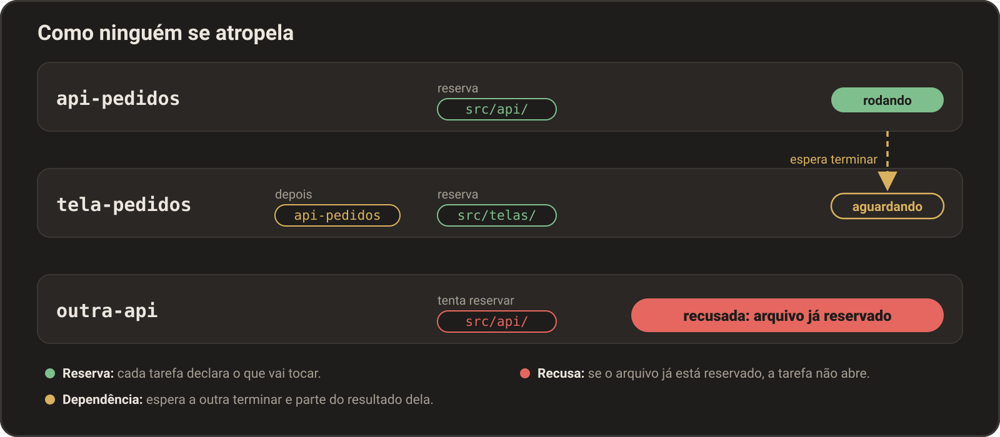
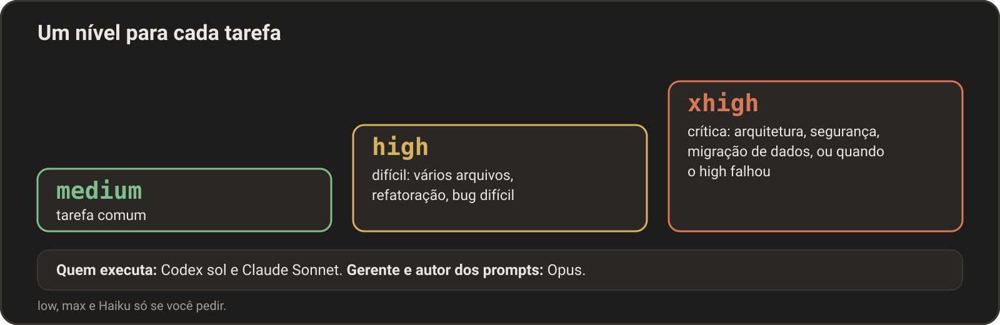
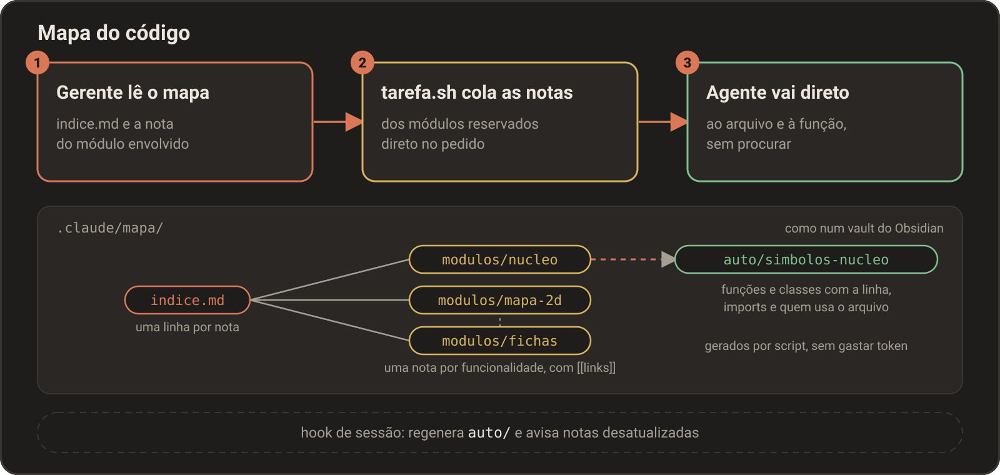

<p align="center">
  
</p>

<p align="center">
  
  
  
</p>

Com o Gerenciador você usa vários assistentes de IA de programação ao mesmo tempo, no mesmo projeto. Você conversa com um só: o **gerente**, um Claude (Opus). Ele divide o pedido em tarefas e entrega cada uma a um agente, que trabalha numa cópia separada do projeto. No fim, o gerente confere e junta tudo.

**Você fala com um só. Ele reparte o trabalho. Ninguém sobrescreve ninguém.**

https://github.com/user-attachments/assets/cf8feabb-28ad-4134-b3b3-23aba276b145

## Como funciona

<p align="center">
  
</p>

| Etapa | O que acontece |
|---|---|
| **Pedido** | Você escreve em português normal o que quer. |
| **Divisão** | O gerente quebra o pedido em tarefas de escopo fechado, escolhe quem faz cada uma e o nível de raciocínio, e escreve o prompt de cada uma. |
| **Execução** | Cada agente trabalha numa cópia própria do projeto (um *worktree*, uma pasta ligada ao mesmo repositório) e numa *branch* própria (uma linha separada de histórico), em paralelo. |
| **Revisão** | O gerente lê o `git diff` de cada tarefa e só então faz o *merge*, que junta a branch da tarefa na principal. |

**Cada tarefa na sua cópia, cada arquivo com um só dono, e nada entra na main sem revisão.**

## Começar rápido

| Onde | O que fazer |
|---|---|
| **1. Instalar** | **Linux, macOS ou WSL:**<br>`curl -fsSL https://raw.githubusercontent.com/Redeziim/Gerenciador/main/install.sh \| bash`<br>**Windows** (PowerShell; usa o WSL/Ubuntu por baixo e instala o WSL se faltar):<br>`irm https://raw.githubusercontent.com/Redeziim/Gerenciador/main/install.ps1 \| iex` |
| **2. Entrar nas contas** | Rode `claude` (e saia com `/exit`) e `codex login`. |
| **3. Abrir** | Na pasta de um projeto que já seja um repositório git (por exemplo `~/projetos/meu-projeto`), rode `gerenciador`. No Windows, tudo roda dentro do **WSL** (um Linux dentro do Windows); guarde o projeto no Ubuntu (`~/projetos/...`), não em `/mnt/c`. |

O instalador confere o que falta (git, tmux, jq, Node...), instala com a sua permissão, baixa o Gerenciador em `~/.gerenciador` e cria o comando `gerenciador`. Pode rodar de novo a qualquer hora: ele só atualiza. Opções: `--sim` (aceita as perguntas com padrão "sim"), `--sem-clis` (não instala Claude/Codex/Gemini) e `--teste` (só mostra o que faria).

Ao abrir, o terminal se divide em dois com o **tmux** (um programa que divide o terminal em painéis): à esquerda o Claude gerente, onde você conversa; à direita o painel, que mostra ao vivo o que cada agente faz. Na primeira vez em cada projeto ele pergunta o **modelo** e o **nível** do gerente (o nível é o quanto a IA "pensa" antes de responder: mais alto é melhor e mais lento); o sugerido é `opus` com `high`. A escolha fica salva e as próximas aberturas não perguntam mais. Para trocar: `/gerente` dentro do Claude, ou `gerenciador --perguntar`.

Exemplo de pedido: *"Crie uma tela de login e corrija os textos do menu."* O gerente divide em duas tarefas (por exemplo, `tela-login` para o Codex e `textos-menu` para o Sonnet), diz numa linha quem faz cada uma e dispara. Quando terminam, ele revisa e junta.

Para sair, digite `/exit` (fecha tudo). Para deixar a sessão rodando em segundo plano, `Ctrl+b` e depois `d`; rodar `gerenciador` de novo volta para ela. O mouse troca entre o Claude e o painel.

## O que você ganha

| Parte | O que é |
|---|---|
| **Painel ao vivo** | No terminal, ao lado do Claude: tarefas, estado, avisos de conflito. Teclas: `↑` `↓` escolhem a tarefa; `c` cancela; `x` tira uma encerrada do quadro; `d` tira e apaga também a cópia e a branch (pede confirmação); `X` limpa todas as encerradas; `l` abre o log; `r` atualiza; `q` sai. |
| **Quadro de reservas** | Cada tarefa declara os arquivos que vai tocar; duas tarefas ativas nunca reservam o mesmo. |
| **Níveis por tarefa** | `medium`, `high` ou `xhigh`, escolhido pelo gerente conforme a dificuldade. |
| **Passagem ao Codex** | Se o token do gerente está acabando, a tarefa vai sozinha para o Codex, que continua de onde parou. |
| **Mapa do código** | Notas por módulo que levam o agente direto ao arquivo e à função, sem gastar token procurando. |
| **Comando `/painel`** | Abre o painel ao lado do Claude (ou fecha e abre de novo, se já estava aberto). |

Símbolos do painel: `✶` rodando, `◌` aguardando, `✓` concluída, `✗` falhou ou bloqueada, `⊘` cancelada. Ele também avisa `⚠ fora da reserva` (o agente mexeu num arquivo que não reservou) e `⚠ conflito` (dois agentes no mesmo arquivo).

| | |
|---|---|
|  |  |
| *O painel no terminal, ao vivo.* | *Reserva, dependência e recusa no quadro.* |

*O print do painel foi feito com um projeto de demonstração.*

## Quem faz o quê (padrões)

| Papel | Quem | Observação |
|---|---|---|
| Gerente (também escreve o prompt de cada tarefa) | **Opus** | O nível é escolhido ao abrir; o sugerido é `high`. |
| Quem executa as tarefas | **Claude Sonnet** e **Codex sol** | Em `medium`, `high` ou `xhigh`. |
| Gemini | Desligado | Só entra se você citá-lo pelo nome, ou pedir uma imagem com o Nano Banana. |

"Codex sol" é o modelo `-sol` mais novo que o Codex tiver. Se você já escolheu outro modelo do Codex, vale o que você escolheu.

<p align="center">
  
</p>

- **Codex sol:** código com escopo fechado, que pode andar em paralelo.
- **Sonnet:** texto, documentação, revisão e o que depende do contexto da conversa.
- Conversas, dúvidas e leituras o gerente responde sozinho, sem chamar agente.

**Tudo isso muda se você pedir, a qualquer momento.** Veja "Como configurar".

## Como uma tarefa funciona

1. **Pedido.** Você pede em português normal.
2. **Quadro.** O gerente mostra os agentes e níveis, divide em tarefas de escopo fechado e diz numa linha quem faz cada uma. Segue sem esperar, mas você pode corrigir.
3. **Worktree e branch.** Cada tarefa ganha sua cópia do projeto e uma branch própria (por exemplo `codex/tela-login`).
4. **Reservas.** A tarefa declara os arquivos ou pastas que vai mexer. Se outra tarefa ativa já reservou algum, a nova não abre. O gerente também reserva o que edita, e um *hook* (verificação automática) o impede de editar o que um agente reservou.
5. **Dependências.** Se uma tarefa precisa do resultado de outra, fica `aguardando`, começa sozinha quando a outra termina e já parte do resultado dela. Se a outra falhar, fica `bloqueada`.
6. **Commit.** Ao terminar, o agente salva o resultado num *commit* (registro permanente das mudanças) na branch da tarefa.
7. **Revisão e merge.** O gerente olha o `git diff` e faz o merge na branch principal.
8. **Descartar.** Para jogar fora uma tarefa: tecla `d` no painel, ou `git worktree remove <pasta>` e `git branch -D <agente>/<nome>`.

**Se o token estiver acabando.** *Token* é a unidade de consumo da IA. Quando o contexto passa de 85% ou a cota passa de 90%, o gerente recebe um AVISO DE TOKEN: para de começar trabalho novo, escreve notas do que foi feito e do que falta e passa a tarefa ao Codex (`passar-para-codex.sh`). O Codex continua numa branch própria, a partir do estado atual, inclusive do que ainda não tinha sido salvo. O gerente avisa você com qual nome a tarefa foi passada.

## Mapa do código

<p align="center">
  
</p>

A cada tarefa nova o agente procurava no projeto (`ls`, `grep`, abrir 15 arquivos) para achar onde mexer, e isso gasta tokens. O mapa resolve: é um conjunto de notas no estilo de um vault do Obsidian, em `<projeto>/.claude/mapa/`, com uma nota por funcionalidade (`modulos/<modulo>.md`: arquivos, como funciona, onde mexer, armadilhas e testes). O `indice.md` (uma linha por nota) e o `auto/simbolos-<modulo>.md` (funções e classes com a linha, imports e quem usa cada arquivo) são gerados por script, sem gastar token.

**Como entra no trabalho**

1. O gerente lê o `indice.md` e a nota do módulo e põe no pedido os arquivos e as funções exatos.
2. O `tarefa.sh` cola no pedido as notas dos módulos que cobrem as `--reservar`. `--nota <modulo>` acrescenta um módulo que a tarefa só lê. O limite é 12000 bytes de notas; acima disso, a nota vai só como caminho.
3. O agente vai direto ao arquivo certo, sem procurar.

**Como se mantém.** Um hook de início de sessão regenera o `auto/` e o índice quando o HEAD mudou e avisa quando há notas desatualizadas (algum arquivo coberto mudou depois do commit em `atualizado`). O gerente pede a um Sonnet que revise só essas notas e roda `mapa.sh <projeto> conferida <modulo>`.

**Como criar.** Peça ao gerente: "crie o mapa do código deste projeto". Ele divide o código em módulos, dispara subagentes Sonnet em paralelo (2 a 3 módulos cada), roda `mapa.sh <projeto> gerar` e confere em "Arquivos sem nota" o que ficou de fora.

**Obsidian.** Abra `.claude/mapa/` como vault para ver o grafo dos módulos.

**Requisito.** O mapa usa o `python3`, só com a biblioteca padrão. Sem ele, o resto funciona e as tarefas saem sem as notas.

**Outra máquina.** O `.claude/` costuma ficar fora do git. Para levar o mapa, versione `.claude/contexto-projeto.md` e `.claude/mapa/`; o `.gitignore` gerado já deixa de fora o que é gerado.

## Como configurar

Os níveis são `low`, `medium`, `high`, `xhigh` e `max`.

| Quero... | Faça... |
|---|---|
| Abrir sem a pergunta de modelo e nível | `gerenciador --modelo opus --nivel high` |
| Abrir outra pasta (ou apelido de projeto) | `gerenciador ~/projetos/meu-projeto` |
| Ver o quadro de agentes e níveis | `/gerente` |
| Outro gerente na próxima abertura | `/gerente gerente <modelo> [nível]`, por exemplo `/gerente gerente opus high` |
| Trocar só o nível do gerente | `/gerente gerente nivel xhigh` |
| Outro modelo ou nível para o gerente agora | `/model` e `/effort` |
| Que o Codex use sempre o mesmo nível | `/gerente codex high` |
| Fixar modelo e nível dos subagentes Claude | `/gerente claude sonnet medium` |
| Que o gerente escolha o nível por tarefa | `/gerente codex auto` e `/gerente claude auto` |
| Ver o modelo e o raciocínio do Codex | `/codex` (e `/codex listar` mostra os modelos) |
| Trocar o modelo do Codex | `/codex gpt-6.1-sol medium` ou `/codex-<modelo>` (por exemplo `/codex-gpt-6.1-sol`) |
| Ver o estado do mapa do código | `/mapa` |
| Regenerar o índice e os símbolos do mapa | `/mapa gerar` |
| Criar o mapa num projeto | Peça ao gerente: "crie o mapa do código deste projeto" |
| Usar o Gemini | Cite-o no pedido: "use o Gemini para revisar os textos" |
| Um nível só numa tarefa | Peça ao gerente: "use o Codex com xhigh nesta tarefa" |

A troca por `/gerente` vale na **próxima abertura**; na sessão aberta, use `/model` e `/effort`.

<details>
<summary><strong>Comandos úteis (scripts)</strong></summary>

Os scripts ficam em `~/.gerenciador/agentes/scripts`. O gerente os usa sozinho, mas você também pode.

| Script | Para quê |
| --- | --- |
| `status.sh <projeto>` | Mostra o quadro: tarefas, reservas e dependências. |
| `painel.sh <projeto>` | Painel ao vivo no terminal. Com `--log <nome>`, mostra o log de uma tarefa. |
| `esperar.sh <projeto> <nome>` | Espera uma tarefa terminar e mostra o resultado. |
| `tarefa.sh <codex\|gemini> <projeto> <nome> --reservar <caminho> "<tarefa>"` | Dispara uma tarefa. `--continuar` segue uma tarefa já terminada, sem reler o projeto. `--nota <modulo>` acrescenta uma nota do mapa. |
| `quadro.sh cancelar <projeto> <nome>` | Cancela uma tarefa. |
| `gerente-config.sh <projeto>` | Mostra o quadro de agentes e níveis. |
| `mapa.sh <projeto> [estado\|gerar\|notas <caminho>...\|conferida <modulo>...]` | Mostra o estado do mapa do código, regenera o índice e os símbolos, diz quais notas cobrem os caminhos ou marca notas como revisadas no HEAD atual. |
| `imagem.sh "<descrição>" <saida.png>` | Gera uma imagem com o Nano Banana (precisa de `GEMINI_API_KEY`). |
| `atualizar-agentes.sh` | Confere (e instala) atualizações do Claude, do Codex e do Gemini. |

`<projeto>` pode ser uma pasta, um apelido (`projetos.sh adicionar <apelido> <pasta>`) ou `.`.

Se o projeto tiver o arquivo `.claude/contexto-projeto.md` (stack, pastas, como rodar os testes), ele entra no pedido de toda tarefa nova e poupa tempo dos agentes.

</details>

<details>
<summary><strong>Pelo celular (OpenClaw + Telegram)</strong></summary>

O [OpenClaw](https://docs.openclaw.ai) roda no computador e conversa com você pelo Telegram. A skill `gerenciador-agentes` ensina o OpenClaw a usar os scripts daqui. O computador precisa ficar ligado.

```bash
curl -fsSL https://openclaw.ai/install.sh | bash
openclaw onboard --install-daemon          # precisa do Node 24.16 ou mais novo
openclaw channels add --channel telegram --token <token-do-bot>   # token do @BotFather
openclaw pairing approve telegram <código> # código que o bot manda na primeira mensagem
~/.gerenciador/agentes/instalar-openclaw.sh demo ~/projetos/meu-projeto
openclaw gateway restart
```

Depois, escreva para o bot em português normal: `status demo`, `pede ao Claude: arruma o bug do login no demo`, `resultado <pedido>`, `cancela <tarefa>`, `faz uma imagem de um mapa de masmorra para o demo`. Merge, push e apagar branches ficam para o computador.

Segurança: só a conta pareada fala com o bot (não troque o `dmPolicy` para aberto); o texto vai para os scripts por variável, nunca dentro do comando; o Claude chamado pelo celular só roda os scripts dos agentes e `git status/diff/log`. Para o OpenClaw só poder rodar os scripts daqui: `openclaw approvals allowlist add "$HOME/.gerenciador/agentes/scripts/*.sh"` e `openclaw config set tools.exec.mode allowlist` (vale para todo o OpenClaw).

Se o bot não responde, rode `openclaw gateway status` e `openclaw doctor`. Se aparecer "comando 'claude' não encontrado", acrescente a pasta da CLI ao PATH do serviço: `openclaw config set tools.exec.pathPrepend '["/home/SEU-USUARIO/.local/bin"]'` e `openclaw gateway restart`.

</details>

<details>
<summary><strong>Problemas comuns</strong></summary>

**Na instalação**

| Sintoma | O que fazer |
| --- | --- |
| `gerenciador: command not found` | Abra um terminal novo. Se persistir, rode `~/.gerenciador/agentes/scripts/iniciar.sh` direto. |
| `EACCES: permission denied` no npm | Faltou o `sudo`. |
| `npm warn install-scripts ... allowScripts` | O Claude Code não terminou de instalar. Rode o instalador de novo. |
| `fatal: unable to access` ou falha ao baixar | Confira a conexão e tente de novo. Se estiver usando um fork privado, rode `gh auth login`. |
| Gemini: `no longer supported for Gemini Code Assist` | Entre com chave de API (`Use Gemini API Key`), criada em aistudio.google.com/apikey. Guarde-a em `~/.config/agentes/env` como `export GEMINI_API_KEY='...'`. |
| Ubuntu não aparece no menu Iniciar (Windows) | PowerShell como administrador: `wsl --install -d Ubuntu`, reinicie. Confira com `wsl -l -v`. |
| O terminal abre em `/mnt/c/WINDOWS/system32` | Rode `cd ~` antes de tudo. |

**Ao rodar tarefas**

Se uma tarefa fica `falhou`, o motivo está no log: `painel.sh <projeto> --log <nome>`.

| Sintoma | Causa e solução |
| --- | --- |
| `erro: defina GEMINI_API_KEY`, mas a chave está no `~/.bashrc` | Scripts em segundo plano não leem o `.bashrc`. Mova a chave para `~/.config/agentes/env` (`chmod 600`). |
| `bad interpreter: /usr/bin/env: 'bash\r'` (Windows) | O Git do Windows trocou o fim das linhas. Clone de novo **dentro do Ubuntu**. Para consertar: `find ~/.gerenciador -name '*.sh' -exec sed -i 's/\r$//' {} +`. |
| `codex`, `gemini` ou `claude` "não encontrado" no WSL | A CLI foi instalada só no Windows. Instale dentro do Ubuntu; `command -v codex` não pode começar com `/mnt/c`. |
| Aviso "mapa do código: N notas desatualizadas (...)" | Algum arquivo coberto por essas notas mudou depois do commit em `atualizado`. Peça ao gerente para revisar só essas notas; ele roda `mapa.sh <projeto> conferida <modulo>` no fim. |
| "mapa do código indisponível" ao abrir uma tarefa | Geralmente uma nota com frontmatter ou codificação quebrados. A tarefa abre sem as notas; `mapa.sh <projeto> estado` mostra o erro. |
| O painel não aparece | Rode `/painel`. O `gerenciador` precisa do `tmux` instalado. |

Os problemas de Windows/WSL desta tabela não foram reproduzidos em testes; ela serve para reconhecer o sintoma.

</details>

<details>
<summary><strong>Segurança e limites</strong></summary>

**O que o projeto protege**

- Reservas: duas tarefas ativas não reservam o mesmo arquivo.
- O hook impede o gerente de editar arquivos reservados por um agente.
- O quadro marca arquivos tocados fora da reserva e arquivos tocados por mais de uma tarefa.
- Nada é juntado à branch principal sem o gerente revisar o diff.

**O que não faz**

- Os agentes recebem as reservas no prompt, mas nada os impede fisicamente de mexer em outro arquivo na cópia deles. Quando acontece, o painel avisa e você decide no merge.
- O hook só vale para as ferramentas de edição do Claude: um comando de terminal que escreve num arquivo reservado passa.
- Reservas feitas pelo gerente ficam valendo até serem soltas (`quadro.sh liberar`).
- Áudio e vídeo ainda não estão montados.
- Pelo celular, o pedido roda até o fim sem poder perguntar nada.
- Testado com agentes simulados (`agentes/testes/testar.sh`) e com Codex e Gemini reais no Linux. Falta testar a conversa pelo Telegram e o uso no Windows/WSL.

</details>

<details>
<summary><strong>Para quem quer mexer</strong></summary>

| Onde | O que tem |
| --- | --- |
| `agentes/scripts/` | Os scripts (tarefa, quadro, painel, configuração...). |
| `agentes/hooks/` | Guarda de arquivos, aviso de token e linha de status. |
| `agentes/GERENTE.md` | As regras do gerente, importadas no `CLAUDE.md` do projeto. |
| `agentes/claude-agents/` | Os subagentes `codex` e `gemini`. |
| `agentes/claude-commands/` | Os comandos `/gerente`, `/codex`, `/painel`, `/mapa` e `/atualizar-agentes`. |
| `agentes/lib/mapa.py` | Gera o índice e os símbolos do mapa do código (só biblioteca padrão do Python). |
| `agentes/mapa-padrao.md` | O padrão das notas do mapa, seguido pelos subagentes que as escrevem. |
| `agentes/instalar.sh` | Liga o gerenciador a um projeto e registra o hook do mapa (o `gerenciador` já roda isso sozinho). |

O quadro de tarefas e os logs ficam em `<projeto>/.git/agentes/` (fora dos commits), e as cópias de trabalho em `<pasta-pai>/.agentes-<projeto>/<nome>`.

Para testar tudo com agentes simulados: `~/.gerenciador/agentes/testes/testar.sh` (a última linha tem que ser "tudo certo"). Ele também roda no CI, em Linux e macOS.

</details>
